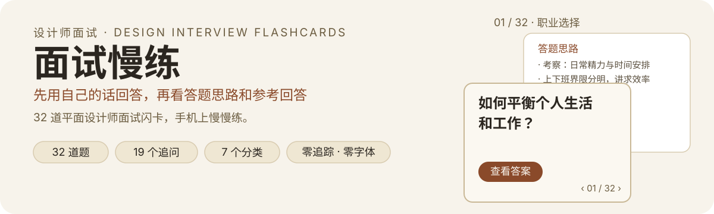
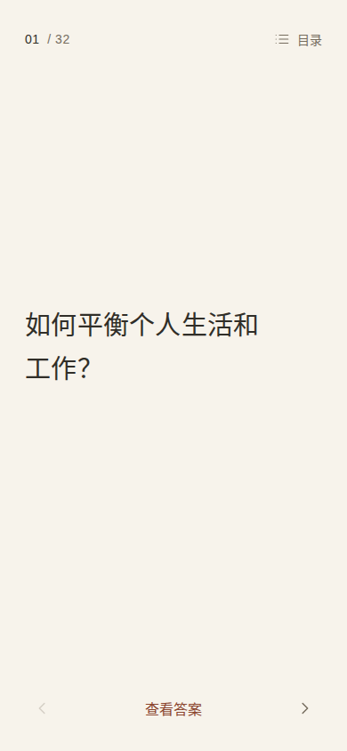
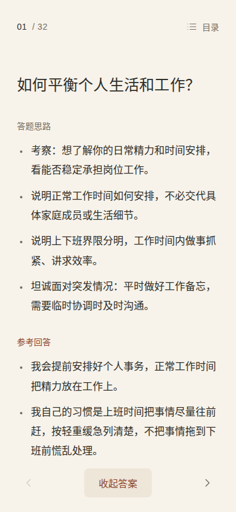

<p align="right"><a href="README.md">中文</a></p>

<p align="center">
  
</p>

<p align="center">
  <a href="https://holynova.github.io/interview-flashcards-public/">▶ Practice Online</a>
  ·
  <a href="https://github.com/holynova/interview-flashcards-public">GitHub Repository</a>
  ·
  <a href="./questions.txt">Full Question Bank (plain text)</a>
</p>

Interview Flashcards ("面试慢练") is a mobile-friendly flashcard deck for design interviews: 32 questions, 19 follow-ups, made for phone reading. Answer in your own words first, then tap 「查看答案」 ("View answer") to reveal what the question is really testing, a thinking guide, and a colloquial sample answer in bullets — practice point by point, no long essays to memorize.

## Screenshots

<p align="center">
  
  
</p>

## The Deck

32 questions in 7 categories, each with the intent behind it, a thinking guide, and a sample answer:

| Category | Questions |
|------|------|
| 项目与协作 (Projects & Collaboration) | 7 |
| 设计基本功 (Design Fundamentals) | 6 |
| 职业选择 (Career Choice) | 5 |
| AI 与新媒体 (AI & New Media) | 5 |
| 深入追问 (Deep Follow-ups) | 5 |
| 商业与设计 (Business & Design) | 3 |
| 现场实战 (Live Practice) | 1 |

Another 19 follow-ups are spread across 6 questions, simulating an interviewer's chain of follow-up questions.

## How to Practice

- **One card at a time**: swipe or tap the arrows to move between questions; progress (the card number) is saved locally, so you pick up where you left off.
- **Answer first, reveal after**: the question face shows only the question — say your answer out loud before checking it against the answer.
- **Catalog & search**: the catalog in the top-right corner lists all questions; you can search questions, categories, and follow-up content.
- **Plain-text version**: `questions.txt` is the full question bank in directly readable form — no browser needed.

## Privacy

This question bank is a set of generic practice examples, not anyone's personal résumé. Names use pinyin initials or placeholders; it contains no tenures, family details, income, contact info, or original conversation links. Please don't put real personal information into the public question bank.

The page only uses local storage to remember the card number — no analytics scripts, third-party fonts, or backend APIs.

## Run Locally

```sh
python3 -m http.server 4182 --bind 127.0.0.1
# Open http://127.0.0.1:4182
```

## Editing the Deck

Edit `content/questions.json`, then run:

```sh
python3 scripts/build-content.py
```

The script syncs the browser deck `content/questions.js` and the directly readable `questions.txt`.

## Tech

- Framework-free static HTML + CSS + JS, no build step; accessibility support (skip link, aria-live announcements).
- The question bank is static JSON; the build script generates the browser version and the plain-text version.

```
index.html               Entry (paper theme, noscript fallback to questions.txt)
app.js                   Flashcard logic: flip / reveal answer / catalog / search / local progress
styles.css               Minimal paper styling
content/questions.json   Question bank source data (32 questions)
content/questions.js     Browser version of the deck (generated by the build script)
questions.txt            Plain-text version of the deck (generated by the build script)
```
