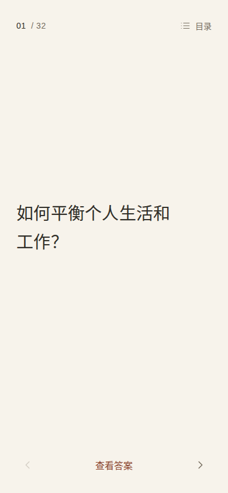
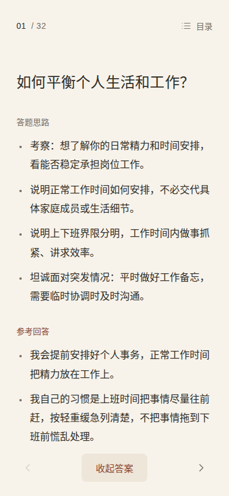

<p align="center">
  
</p>

<p align="center">
  <a href="https://holynova.github.io/interview-flashcards-public/">▶ 在线练习 Practice Online</a>
  ·
  <a href="https://github.com/holynova/interview-flashcards-public">GitHub 仓库</a>
  ·
  <a href="./questions.txt">完整题库（纯文本）</a>
</p>

面试慢练：适合手机阅读的设计师面试闪卡。32 道题、19 个追问，先用自己的话回答，再点「查看答案」看考察点、答题思路和口语化参考回答。答案按 bullet 展开，一条一条对着练，不用背长篇大论。

Slow-paced interview practice for designers: 32 flashcard questions with 19 follow-ups, made for phone reading. Answer in your own words first, then tap to reveal what the question is really testing, a thinking guide, and a colloquial sample answer in bullets — practice point by point, no long essays to memorize.

## 截图 / Screenshots

<p align="center">
  
  
</p>

## 题库 / The Deck

32 道题，7 个分类，每道题都有考察点、答题思路和参考回答：

| 分类 | 题数 |
|------|------|
| 项目与协作 | 7 |
| 设计基本功 | 6 |
| 职业选择 | 5 |
| AI 与新媒体 | 5 |
| 深入追问 | 5 |
| 商业与设计 | 3 |
| 现场实战 | 1 |

另有 19 个追问分布在 6 道题里，模拟面试官的连续追问。

## 怎么练 / How to Practice

- **一张一张过**：左右滑动或点箭头切换题目，进度（题号）存在本地，下次打开接着练。
- **先答后看**：问题面只有题目，逼自己先开口说，再看答案对照。
- **目录与搜索**：右上角目录列出全部题目；可搜索题目、分类与追问内容。
- **纯文本版**：`questions.txt` 是完整题库的可直接阅读版，不开浏览器也能看。

## 隐私 / Privacy

本题库为通用练习示例，不代表任何个人履历。名称采用拼音首字母或占位符；不包含任职年限、家庭成员、收入、联系方式及原始对话链接。请勿在公开题库中填写真实个人信息。

页面只用本地存储记住题号，没有分析脚本、第三方字体或后台接口。

## 本地运行 / Run Locally

```sh
python3 -m http.server 4182 --bind 127.0.0.1
# 打开 http://127.0.0.1:4182
```

## 编辑题库 / Editing the Deck

修改 `content/questions.json`，然后运行：

```sh
python3 scripts/build-content.py
```

脚本同步浏览器题库 `content/questions.js` 和可直接阅读的 `questions.txt`。

## 技术 / Tech

- 纯静态 HTML + CSS + JS，无框架、无构建；无障碍支持（跳过链接、aria-live 播报）。
- 题库是静态 JSON，构建脚本生成浏览器版与纯文本版。

```
index.html               入口（纸面主题、noscript 回退到 questions.txt）
app.js                   闪卡逻辑：翻题 / 揭示答案 / 目录 / 搜索 / 本地进度
styles.css               纸面极简样式
content/questions.json   题库源数据（32 题）
content/questions.js     浏览器版题库（构建脚本生成）
questions.txt            纯文本版题库（构建脚本生成）
```

## English

**Interview Flashcards** ("面试慢练") is a mobile-friendly flashcard deck for design interviews: 32 questions, 19 follow-ups, 7 categories.

- **Answer first, reveal after**: the question face shows only the question; tap to reveal the intent behind it, a thinking guide, and a colloquial sample answer in bullets.
- **Categories**: projects & collaboration (7), design fundamentals (6), career choice (5), AI & new media (5), deep follow-ups (5), business & design (3), live practice (1).
- **Catalog & search** across questions, categories, and follow-ups; progress (current card number) saved in local storage.
- **Privacy**: anonymized generic examples — no real names, tenures, family details, income, contact info, or original conversation links. No analytics, no third-party fonts, no backend.
- **Tech**: framework-free static HTML/CSS/JS. Edit `content/questions.json`, run `python3 scripts/build-content.py` to regenerate the browser deck and `questions.txt`.

## 许可 / License

仓库未附 LICENSE 文件。No license file is included in this repository.
